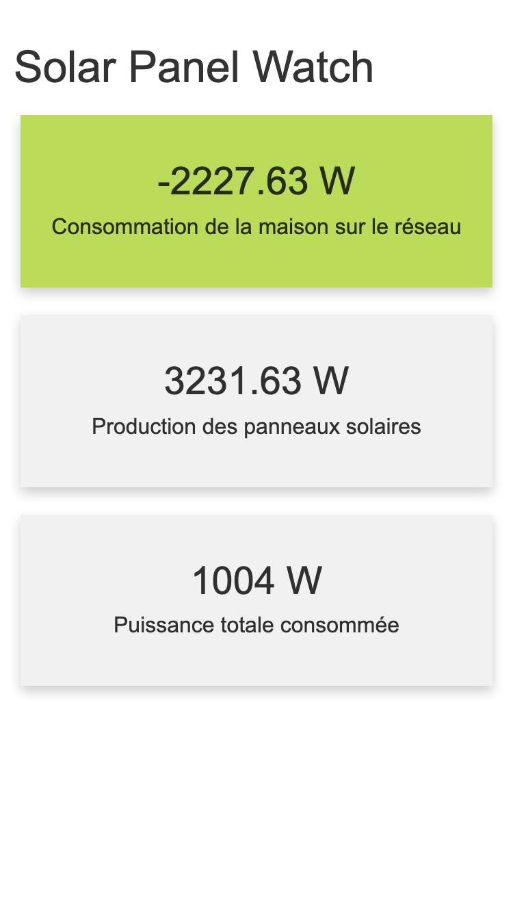

# solar-panel-watch
Watch over electricity consumption from my house.



## config.json

```json
{
    "ip_adress_shelly": "192.168.0.91",
    "influx_tocken": "tocken",
    "influx_org": "cedced19@gmail.com",
    "influx_bucket": "solar-panel",
    "influx_default_tag": "home1",
    "influx_update_delay": 15000,
    "influx_url": "https://**********.influxdata.com",
    "timezone": "Europe/Paris",
    "shelly_req_threshold": 3000,
    "house_power_source": "zendure",
    "zendure_req_threshold": 1000,
    "zendure_request_timeout": 3000,
    "zendure_meter": {
        "host": "192.168.0.48",
        "serial": "TEE1NJP7P341978",
        "mac_address": "E0:72:A1:85:24:48",
        "recover_by_mac": true,
        "power_field": "total_power",
        "power_scale": 1
    },
    "zendure_battery_req_threshold": 20000,
    "zendure_battery": {
        "host": "192.168.0.40",
        "serial": "ANACVCDLP283458",
        "battery_serial": "BEAAVCDLA283460",
        "mac_address": "90:64:9B:10:9A:14",
        "recover_by_mac": true
    },
    "energy_req_threshold": 1200000,
    "target_req_threshold": 240000,
    "force_mode_pass": "7HaIJtG44d"
}
```

## devices-to-activate.json
```json
[
    {
        "uri": "water-heater",
        "power_limit": 400,
        "time_limit": 30000,
        "power_threshold_percentage": 0.05,
        "ids": ["Q7qR9"],
        "priority": 1
    },
    {
        "uri": "heat-pump",
        "power_limit": 1000,
        "time_limit": 35000,
        "power_threshold_percentage": 0.10,
        "ids": ["8yaPTC"],
        "priority": 2
    }
]
```

## docker

```
sudo docker compose up
```

```
sudo docker compose -f docker-compose-npm-install.yml up
sudo docker exec -it solar-panel-watch-node-1 bash # to run in parallel
```

### Development with hot-reload

For development with automatic reloading when `.js` or `.ejs` files change:

```
sudo docker compose -f docker-compose-reload.yml up
```

This uses `nodemon` to watch for file changes and automatically restart the Node.js application. The configuration watches:
- `*.js` files in the root directory
- `lib/**/*.js` files
- `views/**/*.ejs` files
- `bot/**/*.js` files

to remove volume:
```
sudo docker volume rm solar-panel-watch_data
```

## Application power sources and battery

House power now comes from the Zendure Smart Meter 1CT-S. Shelly is polled at
the same time for solar production only. An offline Shelly leaves solar production
and total power unavailable; Zendure house power and device decisions keep working.
If Zendure house power fails, automatic device activation stops until a valid
reading returns. House power never silently falls back to Shelly.

Configure these settings in `config.json` and restart the application:

| Setting | Purpose |
| --- | --- |
| `house_power_source` | `zendure` (configured default) or `shelly` for an explicit rollback. |
| `zendure_req_threshold` | House polling/cache interval in milliseconds; default `1000`, matching the existing Shelly cadence. |
| `zendure_request_timeout` | Deadline for each Zendure HTTP request; default `3000` ms. |
| `zendure_meter` | Meter `host`, expected `serial`, `mac_address`, and `recover_by_mac`. |
| `zendure_meter.power_field` | Field to read from `/properties/report`; default `total_power`. |
| `zendure_meter.power_scale` | Multiply the raw field to obtain signed watts; default `1`. Positive means grid import, negative means export. Set a negative scale if the CT orientation reverses the sign. |
| `zendure_battery_req_threshold` | Independent battery polling/cache interval; configured as `20000` ms. |
| `zendure_battery_full_soc` | Charge percentage from which an idle battery counts as full and devices may run; default `100` (a number from `0` to `100`). |
| `zendure_battery_max_charging_power` | Maximum battery charging power in watts. While the battery charges at this power, devices may use the extra surplus. Unset by default, so devices only run once the battery is full. |
| `zendure_battery_max_charging_tolerance` | How many watts below the maximum still count as "at max"; default `50`. |
| `zendure_battery` | SolarFlow `host`, device `serial`, expected `battery_serial`, `mac_address`, and `recover_by_mac`. |

The supplied device addresses and identities match the standalone probes below.
Enable the local API/HEMS setting in the Zendure app. The library reads LAN status
without cloud credentials or control commands. A returned serial must match when
present; a serial-less meter response remains unverified. MAC recovery uses an
exact match within the configured host's `/24` subnet and keeps the recovered
address in memory.

The battery card shows the matching pack's charge percentage, state and charging
power in watts (`chargingPowerW`, from Zendure's `outputPackPower`). A missing
charging power reading is shown as unavailable; a reported zero remains `0 W`. If pack
charge is unavailable, it uses `electricLevel` and labels it as the device average.
Battery failures show an unavailable state without blocking house power readings. The
server and visible dashboard refresh battery status on its independent interval;
concurrent requests share the same cached reading or in-flight request.

The battery is charged first. Devices (normal, advanced and forced modes) are
activated only when the battery cannot take more power
(see [`lib/battery-logic.js`](lib/battery-logic.js)):

| Battery | Devices |
| --- | --- |
| Discharging | Off |
| Charging at `zendure_battery_max_charging_power` | Allowed |
| Charging below that power | Off |
| Idle and at or above `zendure_battery_full_soc` | Allowed |
| Anything else | Off |

This battery check is a precondition evaluated before any device logic and
only uses the battery's own readings: "at maximum" compares the charging power
reported by Zendure with `zendure_battery_max_charging_power`, and running
devices are not taken into account. Devices also stay off while battery status is unavailable or stale,
or while house power is unavailable. When allowed, the existing surplus,
priority, energy and temperature limits still apply. A small status below the
battery percentage explains whether devices may run and why. Readings expire
after the battery polling interval plus the Zendure request timeout.

`GET /api/data` retains `power1` (house) and `power2` (solar) and includes
`house_power_source`. Unavailable solar power is `null`, never a fabricated zero.
Calendar-day and period energy queries integrate network and solar readings on
their own timelines, holding each reading until the next reading within that day.
Gaps or differing timestamps do not discard the day's solar production or combined
house consumption. Those totals are `null` only for days with no usable solar
readings, and are displayed as unavailable in the energy views.
`GET /api/battery` returns charge/status data or HTTP 503 when unavailable.
Both power and battery responses include `device_charging` with the current
permission (`enabled`), `reason`, measured `socPercent`, `fullSocPercent` and
`maxChargingPowerW`.
Battery level is saved at startup and on each successful background battery poll,
using the `zendure_battery_req_threshold` interval (configured as `20000` ms).
The InfluxDB `battery` measurement contains `socPercent` and, when the device
reports them, `outputHomePower`, `gridInputPower`, `outputPackPower` (charging)
and `packInputPower` (discharging), all in watts. These values come from the same
`/properties/report` request used for battery level, with no extra Zendure call.
Each poll writes one point with the configured `home` tag and the original
battery reading time. Missing or invalid power fields are omitted; zero is saved.
Unavailable or stale readings leave gaps in history. Recording continues even
when house power is unavailable or device charging is blocked.

`GET /api/data/battery/:period` returns battery level history as chronological
`[{"_time": "<ISO timestamp>", "_value": <SOC percent>, "outputHomePower": <watts>,
"gridInputPower": <watts>, "outputPackPower": <watts>, "packInputPower": <watts>}]`
points for the configured home. Power fields are present when recorded; earlier
SOC-only points remain available. For example, `/api/data/battery/24h` returns
the last day, and `/api/data/battery/7d?format=csv` exports all five readings for
the last week, leaving missing values blank. An empty history returns
`[]`; invalid periods return HTTP 400, and database query failures return HTTP 500.
History starts collecting after the application restarts with this version.

`GET /graph/battery/:period` opens the battery history graph with SOC from `0`
to `100` on the percentage axis and the four power series on a separate watts
axis, with time displayed in the configured timezone. Missing power readings
leave gaps in the graph; the new power history begins after restarting with
this version. The dashboard
links to `/graph/battery/24h`; the page also offers two-hour and seven-day views,
a CSV download, and messages for empty history or a failed request.

InfluxDB history uses the selected house source and omits missing solar fields
and network measurements that Zendure does not provide.

The observed 1CT-S response exposes `total_power`, but the official zenSDK
reference does not specify its scaling or sign. Verify `power_scale` against
the Zendure app and a known import/export condition before relying on surplus
power decisions.

## Standalone Zendure Smart Meter probe

Run the read-only probe from a computer on the meter's LAN, using Node.js 18 or newer.
It uses only built-in modules and does not load the application configuration:

```bash
node try-zendure.js
node try-zendure.js --host 192.168.0.48 --timeout 3000
node try-zendure.js --help
```

The defaults identify the Smart Meter 1CT-S at `192.168.0.48`, serial
`TEE1NJP7P341978`, identity `492848`, fallback MAC `E0:72:A1:85:24:48`.
The script tests TCP ports and reads
`/properties/report` and MQTT status over HTTP. It handles both nested zenSDK
properties and the flat 1CT-S response (`total_power`, `a_aprt_power`,
`b_aprt_power`, `c_aprt_power`). It prints raw values without assuming units or
scaling. A response without a serial number cannot confirm the meter's identity.
Exit code 0 means a tested LAN TCP service opened, 1 means none opened, and 2
means invalid options or a failed optional cloud lookup.

If the configured IP returns no meter report (or returns a different serial),
the script finds the fallback MAC in the system ARP/neighbor table and retries
at that IP. If the address is not cached, it makes short TCP connection attempts
within the configured IP's `/24` subnet to populate the table, with at most 16
connections at once. Only an exact MAC match is used for recovery; the configured
IP is not changed on disk. MAC discovery requires the computer and meter to be
on the same LAN and uses `ip neigh` (or `/proc/net/arp`) on Linux and `arp` on
macOS/Windows. It reports when those facilities are unavailable.

```bash
node try-zendure.js --mac E0:72:A1:85:24:48
node try-zendure.js --no-mac-fallback
```

The supplied authorization key belongs to the cloud API. To also check whether
the meter appears in that API, enter the key without storing it in source or
shell history:

```bash
read -r -s -p 'Zendure key: ' ZENDURE_KEY
echo
export ZENDURE_KEY
node try-zendure.js --cloud
unset ZENDURE_KEY
```

Cloud mode lists matching devices and never prints MQTT credentials. A cloud
match does not establish LAN reachability or provide live readings. Credentials
are accepted only for Zendure's documented HTTPS API host. The local endpoint
is described in [Zendure's zenSDK documentation](https://github.com/Zendure/zenSDK);
cloud authentication follows the [official Home Assistant integration](https://github.com/Zendure/Zendure-HA/blob/master/custom_components/zendure_ha/api.py).
The zenSDK support list names SmartMeter3CT; local 1CT-S readings have been
observed at this IP, but support on other firmware versions is unconfirmed.

Run the probe's focused tests with `node --test test/zendure-probe.test.js`.

## Standalone Zendure battery probe

Read the SolarFlow 3000 MIX AC+ charge level from a computer on its LAN, using
Node.js 18 or newer:

```bash
node try-zendure-battery.js
node try-zendure-battery.js --host 192.168.0.40 --timeout 3000
node try-zendure-battery.js --help
```

Defaults identify the device at `192.168.0.40`, serial `ANACVCDLP283458`,
identity `492766`, MAC `90:64:9B:10:9A:14`, and the built-in battery (Akku 1)
with serial `BEAAVCDLA283460`. The probe shares the meter's network, MAC recovery,
credential redaction and optional cloud lookup helpers. It uses only Node.js
built-in modules and does not load the application configuration.

The script reads `/properties/report` and MQTT status, then displays:

* Current charge percentage from the exact matching battery's `packData.socLevel`.
* Device average charge from `properties.electricLevel`, used as a fallback when
  the expected pack's charge percentage is unavailable.
* Battery charging power (`outputPackPower`) and discharging power
  (`packInputPower`) in watts, plus the matching pack's own `power` reading.
* Battery state: standby, charging or discharging, with device and pack serial
  verification reported separately.

These fields follow [Zendure's SolarFlow property reference](https://github.com/Zendure/zenSDK/blob/main/docs/en_properties.md).
The supplied MIX AC+ returned both serials and these fields during a local check.
Pack power and device charging power are distinct measurements and are shown
separately. A different device serial or `dataReady: 0` prevents the response from
being used as a current charge reading. If the expected pack is absent, any
available charge percentage is explicitly labelled as the device average.
No charging commands or configuration changes are sent.

The battery probe supports `--battery-serial`, `--mac`, `--no-mac-fallback`,
`--serial`, `--id`, `--ports`, `--timeout`, and `--cloud` with the same
`ZENDURE_KEY` setup described above. Cloud mode only lists matching devices;
it does not supply a live charge percentage. Exit code 0 means a usable LAN charge
reading was received, 1 means none was received (even if a TCP service opened),
and 2 means invalid options or a failed optional cloud lookup.

```bash
node --test test/zendure-battery-probe.test.js
```

## TODO

* Add documentation on config files
* Add a night mode in order to prevent calculation and communications during night
* Add a UI to configure the system
* Improve the debug system to adapt the period of request to the value

## Exec bash on container

```
docker exec -it solar-panel-watch-node-1 /bin/sh
```

## Device Disconnection Mechanism in `is_device_connected`

The is_device_connected function checks if a device is still connected to a server based on the time of its last call. If the elapsed time since the last call is less than 50 times the `time_limit value`, the function returns true, indicating that the device is still connected. Otherwise, the function returns false, indicating that the device is disconnected.

The mechanism for device disconnection in this function is based on the assumption that a device should make regular calls to the server within a certain time frame. If the device fails to make a call within that time frame, it is considered disconnected. The time frame is determined by the  `time_limit` parameter, which represents the time in milliseconds between device calls to the server. The maximum allowed time between calls is 50 times the `time_limit` value, which is calculated in the function as `max_allowed_time = 50 * time_limit`.

When the `is_device_connected` function is called, it first calculates the elapsed time since the device's last call using the `Date.now()` method to get the current time in milliseconds since the epoch and subtracting `last_call` from it. If the elapsed time is less than max_allowed_time, the function returns true, indicating that the device is still connected. Otherwise, the function returns false, indicating that the device is disconnected.

By checking if a device has made a call to the server within a certain time frame, the `is_device_connected` function provides a simple and effective mechanism for determining if a device is still connected to a server. This mechanism can be used to trigger appropriate actions or alerts when a device is disconnected from a server.
